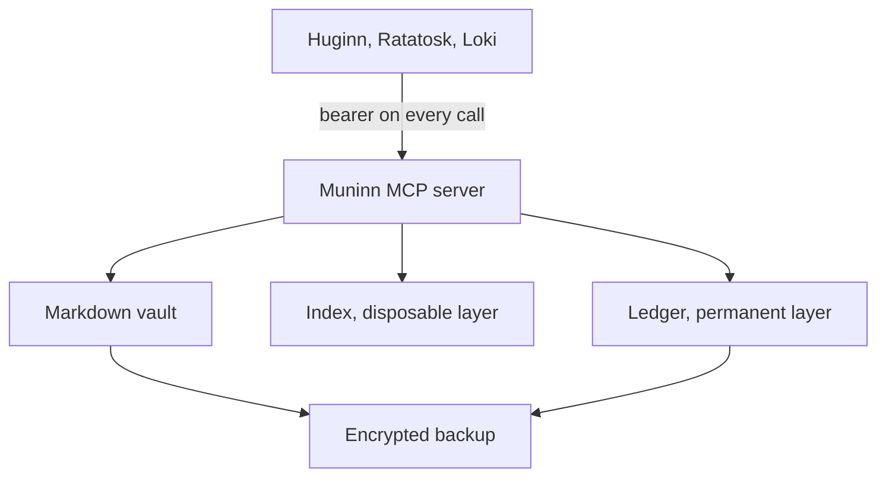

My [phone-brain post](/blog/self-hosted-ai-agents) covered the agents. This one covers the shared memory they all read from and write to. In my setup it is called Muninn: an Obsidian vault, exposed as a small [MCP](https://modelcontextprotocol.io) server. Huginn, Ratatosk, and Loki all reach it through the server. One honest caveat: the files are also just files on a machine, so anything that can reach it by SSH can edit them directly. The system does not try to stop that. It just makes the door the better option. One correction on naming: the memory is the vault. Muninn is the door.

By early October four things were wrong with that memory. Search could not find the right note. Nothing could be undone. Summaries went stale without anyone noticing. Every agent wrote on its own terms.

## My opinions, up front

- **The memory is files. The server is the door.** No agent owns the notes.
- **Search quality is the first cost in shared memory.** The old search found the right note in 0 of 44 test questions.
- **Undo is a core feature.** Several agents overwrite the same notes daily.
- **A hash is a freshness check, not a truth check.** It catches drift between files. It does not catch a wrong fact.

## The structure

The guiding idea is old: memory should be files a human can open, and everything else should be a replaceable client. The vault is plain markdown: frontmatter, wikilinks. Obsidian reads it, I read it, no agent owns it.

On top of the vault sit two layers, both server-managed SQLite, both deliberately not notes.

- **The index.** Derived from the vault: a full-text database over every note, weighted toward titles, tags, and frontmatter, daily logs downranked. Disposable: it rescans every 20 seconds, and if it breaks it is rebuilt.
- **The ledger.** Records what happens to the vault: the preserved bytes of every archive and overwrite, their hashes, the claims, the staleness registrations. Permanent, and the undo substrate.

Not-notes is the point. History must be readable, but it must not be a note a model can edit or an agent search surfaces. The MCP server is the single door to the vault and both layers.

Two rules bind the layers. Disposable and permanent live in different places: lose the index, you lose nothing; lose the ledger, you lose every undo, so the ledger rides in the backup. And backup is restore, not sync. Nightly the vault and the ledger are sealed, pushed to a private repo, restored, and compared before the run reports ok. Nothing ever pulls the backup back into the readable vault. The agents never touch the backup, and the backup never touches the live files.

## How the door works

Every call carries a bearer token for its client. Missing or wrong is a 401. The interesting decision is in the read. A read returns the SHA-256 of the exact bytes, and a write must present it: the hash of what you last read, or "missing" when you create the file. That one number is the entire concurrency story. You cannot write a file you have not read, and you cannot write one that changed after you read it.

So a write goes: read, keep the hash, dry run, commit, read back. The dry run is the full validation with zero side effects. And the rules are part of the protocol, because the server publishes the write contract as a versioned object; advertised and enforced come from the same code. Warnings ride with the data, attached to ordinary reads and searches.

## The search

The old search was a substring scan. I measured it on 44 test questions, each with a known right note (Table 1).

**Table 1.** Retrieval on 44 curated questions.

| Engine | Top-1 | Top-5 |
|---|---:|---:|
| Substring scan | 0% | 7% |
| Full-text index, BM25 | 59% | 86% |
| + local reranker | 80% | 91% |

The index is the one from the structure section. If it breaks mid-question, the server falls back to the scan and marks the result. The tempting alternative, handing the model the whole index on every question, is a tax on every question, so the index stays a ranking, not a corpus.

The reranker is a local model on [Freyr](/blog/self-hosted-ai-agents). It reorders only the top 15, and only when the top two scores are within 10%, about half my queries, about 0.4 seconds. Private notes never reach it. A link tool returns backlinks, outgoing, and broken links for any note. 9% of questions still miss top-5, and 44 questions is a small test set.

## No deletes

The delete tool is gone; a call to it returns unknown tool. Archiving is the only way a note leaves the active vault, and it commits the original bytes, their hash, the path, and a reason into the ledger before the file leaves. If that commit fails, the original is untouched. Restore writes a version back on its original path only, and only if that path is empty. Overwrites the same way, under the reason superseded. The ledger is in the encrypted backup, so undo survives a dead disk, not just a bad write.

I added claims on top. A claim binds a statement to a source file and the exact revision I read it. The claim returns only while the source holds that revision; otherwise it abstains. Archiving a note as retracted is a retention label, not a retraction of the claims it carries. The claims stay, abstaining, until I deal with them.

## Stale summaries

Notes that summarize other notes go stale when the sources change, and until October nobody knew. A summary now registers its dependencies by hash: its own file and hash, plus the exact source files and their hashes. The server re-reads each source, checks the bytes, and appends the registration to the ledger atomically, budgeted at 128 file checks and 16 MiB so no graph can wedge the read path. A changed source marks its summaries stale, and the summaries of those summaries with it. It is hash-based, said plainly: a summary whose sources are unchanged is current, and it can still be wrong about the world.

## Guarded writes

Two layers. Metadata first: every non-private write needs valid frontmatter, unique keys, a non-empty title, type, and status, two to five kebab-case tags, and a date. Invalid writes fail before any directory, history event, or index change. Then the transaction: the note and its folder index entry land together; if they cannot, the server returns a pending id, and a later recover replays it only while the bytes still match, otherwise superseded, never rebased. The locks cover cooperating MCP clients only, so a writer that goes around the door is detected by bytes later, not stopped. Advisory warnings, like search first, ride in the same responses but never block a committed write.

## The code mode

Read-only JavaScript runs in a QuickJS sandbox over the vault: allowlisted reads and searches, no writes, no shell, no network. The server, not the script, attaches source paths, hashes, and citation ranges to the answer, plus a truncation note. Partial retrieval cannot look complete.

## The new home

The stack moved in the same month: Loki and Muninn run on a Mac mini now, and the phone from [the last post](/blog/self-hosted-ai-agents) is a cold restore image. The last verified nightly backup covered 5,167 files, restored and compared before it reported ok.

## What this does not prove

- **The hash is not the fact.** Sources unchanged means current. The world can still move.
- **The reranker only fixes close calls.** Far apart scores never reorder.
- **The test set is 44 questions.** My own vault, one point in time.
- **Warnings do not rewrite.** A stale summary sits stale until I fix it.

## What is next

Semantic lint scoped to the evidence that actually changed. The same frozen questions against each consumer. Explicit retraction for claims, separate from archiving. None of them has a number yet. I write about them when one does.

---

This is the follow-up to [my phone-brain post](/blog/self-hosted-ai-agents), where the reranker [left Mimer](/blog/slower-then-faster) for Freyr.
