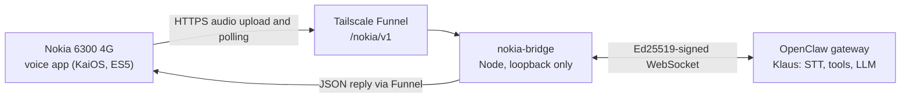

Klaus is the company AI I build and run at [EcoRay](https://ecoray.dk). It lives on a VPS behind an [OpenClaw](https://openclaw.ai) gateway, and it already had the hard parts: speech recognition, tools, and a model. What it did not have was a terminal that stays in a pocket.

Someone in the office wanted to talk to it from a phone that is not a smartphone. He had a Nokia 6300 4G, a 2021 reissue of a 2007 classic, so that was the phone I built for. The phone stays dumb. The agent stays on the server. Now the two can have a conversation.

This post is about what that took, what I verified, and what I could not verify. It is work, and an experiment, and not a product.

## My opinions, up front

- **A phone this dumb is the right hardware for the job.** It fits in a pocket, its battery is removable, and I could push code onto it without replacing the stock OS.
- **Leave the OS stock.** No custom firmware, no unlocked bootloader. The whole modification is two small apps.
- **The phone should hold almost no power.** A stolen handset should expose one assistant, not the gateway behind it.
- **Send audio up, send text back.** The phone reads the reply with its own voice, so the data path is one upload and a small JSON poll.
- **I will not report a number I have not measured.** There are no latency figures in this post, because I have not benchmarked them.

## The hardware

The Nokia 6300 4G (model TA-1287) runs KaiOS 2.5. Its apps are web apps running on Gecko 48. I kept the JavaScript ES5-compatible for that old runtime. The phone has 512 MB of RAM, a 2.4 inch 240 x 320 screen, a removable 1500 mAh battery, 4G, and it weighs about 105 grams.

What makes this possible is that the OS exposes the hardware as web APIs: getUserMedia for the microphone, the Web Speech API for speech, and privileged XHR for HTTPS calls a normal page cannot make. There is no custom firmware here. The phone-side addition is two small web apps.

## The shape of the system

Three parts:

- **nokia-klaus**, the voice app: records, sends, shows the reply, reads it out.
- **nokia-launcher**, a home screen with three entries: Klaus, Phone, SMS.
- **nokia-bridge**, a small Node server on the VPS. It listens on loopback only and translates the app's HTTP requests into signed WebSocket calls. The phone's connection is HTTPS; Funnel terminates TLS before forwarding to the loopback bridge.

The phone reaches the bridge through Tailscale Funnel, a public HTTPS route scoped to `/nokia/v1`. It exposes the bridge API, not a general gateway endpoint.

Press the centre key to record, press it again to stop and send. The audio goes up as Ogg. Klaus transcribes it, works, and writes a reply. The app polls the bridge for the reply, draws the transcript on the small screen, and speaks it with on-device speech.

No synthesized reply audio comes back down. The phone receives text rather than a second audio stream. I have not benchmarked the bandwidth or latency.

Conversations are per-session: 3 starts a new one, left and right switch, up and down scroll the transcript, 5 replays the last reply, and 7 archives after a confirmation. The stock kernel, modem, and audio stack all stay stock. The apps were pushed over the stock developer connection.

## Security: how little the phone knows

- The phone holds a bearer token. It authorizes only this bridge's session API, not the gateway. I probed the route with a wrong token and with no token at all, and both probes got 401.
- The bridge has its own identity at the gateway: Ed25519 signed, read-write operator scope, no admin.
- The token ships in plain text inside the phone package. I accepted that trade for a single-user device. Provisioning reloads on every request, so revocation is emptying the token list.
- The trade has a limit. The route sits on a VPS that runs other services. Auditing those other routes is separate work, and this project does not include it.

## Where it stands today

Verified: a real conversation with microphone audio in and a spoken and written reply out, session switching and archiving, 401 on bad tokens, and the phone coming back after a restart. The running gateway never restarted for this addition.

Not verified, in order of how much it worries me:

- **Not a kiosk.** The app-blocking policy is reversible development tooling, not proven strict lockdown.
- **No Danish.** The tested phone ships six local voices, including English, French, German, Spanish, and Italian. So the agent answers in English.
- **One device.** Proven on the TA-1287 with KaiOS 2.5 and Gecko 48. The 8110 is untested, and I will not claim otherwise.
- **Pinned protocol.** The bridge speaks the WebSocket contract of our gateway deployment, version 4. It is not a general OpenClaw bridge.
- **Unexercised paths.** The agent's email and identity tools have not been exercised from the phone. Cancellation, concurrency, archiving edge cases, network loss, and losing power mid-turn remain incompletely qualified.
- **Not a full recovery qualification.** A handset restart is not a VPS reboot test. Normal calls and SMS, final debug/timeout cleanup, and the unresolved USB recovery path still need work. Installed packages also need to be checked against the final source before calling the setup reproducible.

## The source

The source is public under MIT: [lucasfth/nokia-voice-openclaw-gateway](https://github.com/lucasfth/nokia-voice-openclaw-gateway). The bridge, both apps, the setup, security, and compatibility docs, and offline tests that build green from a clean clone.

Not in it: firmware images, boot and recovery tooling, identity keys, or conversation data. I extracted the public tree by explicit allowlist, not by copying my configuration history. The secret scanner found nothing, and a literal line-by-line scan found a hostname in a test fixture the scanner did not classify. A scanner is not a review.

The app still says ECORAY / KLAUS in the header. This is my personal project under MIT, not an official EcoRay product and not a claim of company endorsement.

If you find a TA-1287 and a SIM, the README will get you most of the way. Danish is on you.