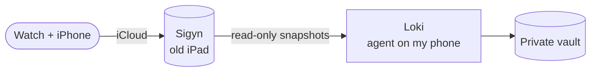

I have been tracking the same health data for seven years. Watch, scale, phone. The data was never the problem. The problem was that it sat in three places, and cross-checking anything meant exporting and sitting down with a spreadsheet at midnight.

So I gave the agent a fourth place. This is the honest version of what happened, including the part where I wrote down a completely wrong conclusion.

If you have not read [how I run my agents](/blog/self-hosted-ai-agents), that one comes first. It has the roster: Loki, Huginn, Ratatosk, Muninn. This post is where Sigyn enters. Sigyn is an old iPad stuck on iPadOS 17 because Apple stopped updating it, so I jailbroke it and hardened it myself. It is the door my agent uses into everything Apple-side. Reminders, Find My, Uber, health data. Health data is the widest thing behind that door, so this post is about that one.

## My opinions, up front

- **The data was already in my cloud. The switch was off.** That is the whole first act of this post.
- **Cross-checking is the check.** One source always lies slowly. Two sources that disagree are where the truth shows up.
- **I have 2,964 workouts without sport names.** The database does not label its rows, and I am done pretending it does.
- **The method goes on this site. The numbers do not.**

## The part that went wrong first

Apple Health syncs a full phone history to every device on the account through iCloud. So Sigyn could hold it all if the receiver switch was on. It was not. It had been off since install.

My first investigation pass read the database, found almost nothing, and I wrote down "no health data, probably no iCloud sync". That was a lie. The data was four million rows deep in the account. The switch I never checked kept it off the iPad. I enabled it with the agent doing the clicking while I watched the screen, fresh rows started arriving within minutes, and the full backfill settled a few hours later: a bit over a gigabyte of health database, activity going back to 2018.

The rule I keep from that: an absence claim is a snapshot claim. It needs a date, a device and a depth, because I have a documented record of checking real hard for something and finding nothing that was there.

## The database Apple does not document

Apple ships the numbers, not the name table. Timestamps sit on Apple's own epoch, 1 January 2001, so the first job of any script is proving its date math says something sane. The workout rows carry internal numeric type IDs with no sport names, which is how I got to 2,964 recorded workouts and enough verification to name a handful of them. The rest stay "exercise on a day".

The snapshot bites back too. The database is written while I read it, and a copy taken mid-write is corrupted in exactly the pages that were being written. Check integrity, retry those queries, move on.

The zero-row read taught me the rest. A pipeline that reads an empty view and reports "nothing there" is a pipeline that has not found anything. The shape of that first mistake is the one I did not want to repeat.

## The cross-checking is the point

One source always disappoints. Line up a second one and the disagreement is the useful part.

The scales are the classic case. My home BIA scale and a professional body scanner in a clinic disagree with each other, badly enough that I measured with both on the same day in 2026 and cross-checked both against what the mirror shows. One of the devices is close to reality. One is not. Since that day the home scale is a trend line with a calibration, not a fact, and the two get a flag any time they start to drift apart. I never average them. BIA devices measure on different assumptions and drift on different clocks, and averaging them just makes the two errors cancel into one confident mistake.

Sleep went the other way. I pulled a ninety night window and only a third of the nights had any record. It is not a mystery. I did not wear the watch most of those nights. Loki finds the hole in the data. I know why it is there. That is the first and most important cross-check in a dataset like this.

Put the pieces together and the overview gets genuine. The watch covers daily activity, sleep and heart rate across several years. The scale covers weight and composition since 2018. The clinic scanner gives me one properly calibrated anchor point instead of a hunch. None of them alone is enough to trust, and together they rule each other in or out. That is a wider and stronger view of my body than I had before, and that was the point.

It also makes the mistakes visible. One overnight heart rate reading is impossible for resting, so it is an artifact, marked and kept out of the averages. Some months the scale stops and the chart gets a gap instead of a guess. A wide source does not hide its own weak points. It prints them.

## The numbers stay private

The analysis, the calibration and the rules live in my private Obsidian vault, the same markdown files Muninn serves to the other agents. The measurements stay there, and I think that is the right default in 2026. The method is public. The values are mine.

Access goes the same direction. The assistant reads snapshots, read only, and the one step that changed anything, the sync switch, happened with my approval while I watched the screen. Health data is a category where "the agent could have done it" is not a valid reason to do it.

## What I would warn you about

- **The jailbreak is semi-tethered.** After a cold reboot, Sigyn only comes back if I sit next to the Mac and run the cable-and-DFU dance. It is a shelf I maintain, not infrastructure I forget.
- **I am reading a private schema.** Apple can change column names or type meanings in any update, and every assumption I write down needs re-verification against a live device. Miss that and you get a second zero-row incident with a better story.
- **Sigyn is a copy.** The relay is my phone, and the phone is the single point. If that chain breaks, the history stops, and a gigabyte of rows on old hardware queries slowly enough to keep the query count low.

## What you can copy

1. One trusted device as the destination for scattered health data, and a sync you verify lands. Size, date range, newest timestamp.
2. Read-only snapshots for the agent. Nothing that writes back.
3. Every number you care about cross-checked against at least one other way of knowing. The disagreement is the point, not the error.
4. Method public, measurements private.

I am not a healthier me after this. I am an informed one, which is what I was actually after.